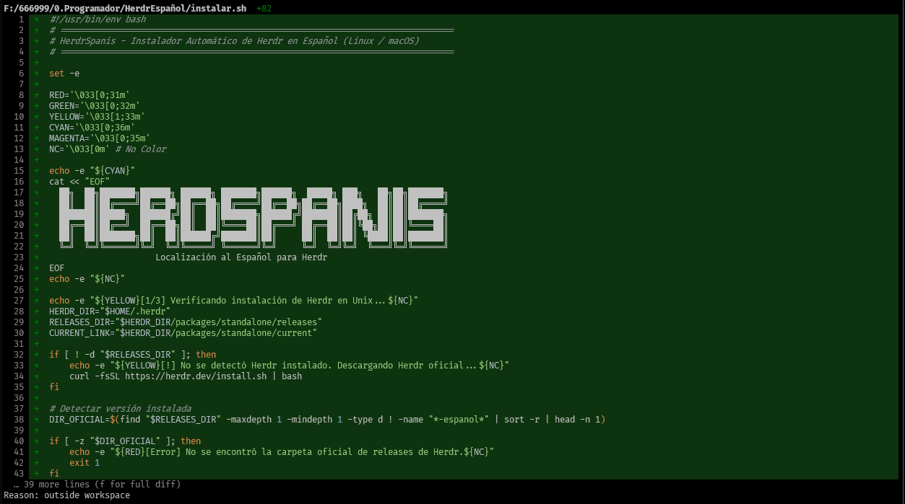

<div align="center">

# 🇪🇸 HerdrSpanis 🚀

[](https://herdr.dev)
[](https://github.com/quijotevitruvio/HerdrSpanis/stargazers)
[](https://paypal.me/bibliotecologo)
[](https://x.com/quijotevitruvio)
[](https://www.linkedin.com/in/andr%C3%A9s-valencia-tob%C3%B3n/)
[](https://www.tiktok.com/@quijotevitruvio)
[](https://github.com/quijotevitruvio/HerdrSpanis)
[](https://opensource.org/licenses/MIT)

### 🗼 La Torre de Control para programar con Inteligencia Artificial, ahora 100% en Español ✨

**¿Para qué sirve?**  
Coordinar múltiples IAs a la vez (**Google Antigravity**, **Claude Code**, **Nous Hermes**, **OpenCode**, **Devin**) en una sola ventana organizada, sabiendo en tiempo real si cada agente está `Listo`, `Trabajando...` o `Esperando tu respuesta`.

**¿Qué hace HerdrSpanis?**  
Traduce de raíz absolutamente **toda la interfaz de Herdr al español** con 1 solo comando, sin perder el binario oficial ni tus configuraciones.

<br/>

<p align="center">
  
</p>

---

### 🌐 Selecciona tu Idioma / Select your Language

[🇪🇸 **Leer en Español (Guía para Principiantes)**](#-español) &nbsp;&nbsp;|&nbsp;&nbsp; [🇬🇧 **Read in English (Beginner Guide)**](#-english)

---

</div>

<br/>

<details open>
<summary><h2 id="-español" style="display:inline;">🇪🇸 Español — Guía Paso a Paso</h2></summary>

### 💡 ¿Qué es Herdr y por qué lo necesitas? (Explicación Lógica)

Piensa en **Herdr** como una **Torre de Control de Aeropuerto para tus agentes de Inteligencia Artificial**:

* **El problema habitual:** Cuando programas con varias IAs (Antigravity, Claude Code, Hermes, OpenCode, Codex), terminas con 5 ventanas de terminal sueltas. No sabes cuál terminó, cuál se quedó colgada esperando tu confirmación o cuál sigue procesando.
* **El nombre:** En inglés, *"Herd"* es un rebaño y *"Herdr"* es el **pastor** que cuida y organiza ese rebaño de IAs.
* **Lo que hace:** Agrupa todas tus IAs en una sola ventana organizada y vigila el estado de cada una en tiempo real:
  * 🟢 **Listo:** La IA terminó y está a la espera de nuevas tareas.
  * 🟡 **Trabajando...:** La IA está ejecutando comandos o escribiendo código.
  * 🔴 **Esperando tu respuesta:** La IA se detuvo y requiere tu aprobación (`Enter/Y`).

```text
┌─ espacios ──────────────────┐┌─ 󰚩 Antigravity (Listo) ──────────────────────────┐
│                             ││ $ agy "auditar proyecto"                        │
│ 󰈸 mi-proyecto-principal     ││ > Analizando dependencias y rutas...            │
│ 󰭻 bot-asistente             ││ > Todo verificado con éxito.                    │
│                             ││                                                 │
├─ agentes ───────────────────┤├─ 󰭻 Claude (Trabajando...) ───────────────────────┤
│ 󰚩 Antigravity  [Listo]      ││ Investigando arquitectura de componentes...     │
│ 󰭻 Claude       [Trabajando] ││                                                 │
│ ⚚ Hermes       [Esperando]  ││                                                 │
└─────────────────────────────┘└─────────────────────────────────────────────────┘
```

> **¿Qué aporta HerdrSpanis?**  
> Traduce el **100% de la interfaz** (`espacios`, `agentes`, `menú`, configuración), traduce los estados de las IAs a español real y les asigna sus **iconos tipográficos oficiales** para que las reconozcas al instante.

---

### 🚀 Instalación en 1 Solo Paso (Elige tu sistema)

#### En Windows (PowerShell o Windows Terminal):
```powershell
irm https://raw.githubusercontent.com/quijotevitruvio/HerdrSpanis/main/instalar.ps1 | iex
```

#### En Linux / macOS (Bash o Zsh):
```bash
curl -fsSL https://raw.githubusercontent.com/quijotevitruvio/HerdrSpanis/main/instalar.sh | bash
```

---

### 🧭 Elige tu situación actual:

#### 🟢 Camino 1: Si YA tienes Herdr instalado en inglés
* **¿Se borran mis proyectos, pestañas o configuraciones?**  
  **¡No, absolutamente nada!** Todo tu trabajo, historial y configuraciones permanecen 100% intactos.
* **¿Qué hace el instalador?**
  1. Detecta tu versión oficial en inglés.
  2. Guarda una copia de seguridad automática llamada `herdr-original.exe` (así nunca pierdes lo oficial).
  3. Activa la versión en español para esa misma versión y la conecta al sistema.
  4. Deja listos los comandos para alternar (`herdr-idioma en` para volver a inglés oficial, o `herdr-idioma es` para volver a español).
* **Para verlo:** Cierra tu ventana actual de Herdr, abre una terminal nueva y escribe `herdr`.

#### 🔵 Camino 2: Si es tu PRIMERA VEZ y lo quieres en español desde cero
* **¿Necesitas descargar algo antes?**  
  **¡No necesitas nada previo!**
* **¿Qué hace el instalador?**
  1. Detecta que no tienes Herdr en tu equipo.
  2. Descarga e instala la versión oficial de Herdr de fondo.
  3. Aplica de inmediato la traducción completa al español y activa los iconos tipográficos oficiales para cada IA.
  4. Configura el comando `herdr` globalmente en tu sistema.
* **Para comenzar:** Abre una terminal nueva, escribe `herdr` y listo para programar.

---

### 🎮 Comandos Globales y Cómo Usarlos

Una vez instalado, usa estos comandos directamente en cualquier terminal:

| Comando | ¿Qué hace? | ¿Cuándo usarlo? |
| :--- | :--- | :--- |
| `herdr` | Inicia Herdr completamente en español. | Para tu trabajo diario con agentes IA. |
| `herdr-idioma es` | Activa el modo **100% en Español**. | Cuando quieras ver la interfaz traducida. |
| `herdr-idioma en` | Vuelve al **Inglés oficial de fábrica**. | Cuando quieras usar temporalmente el binario original intacto. |
| `herdr-idioma` | Consulta qué idioma está activo. | Para verificar el estado de tu instalación. |
| `herdr-actualizar-es` | Actualiza y sincroniza con nuevas versiones. | Cuando el equipo oficial de Herdr lance una actualización. |

---

### ✨ Iconos Canónicos de Agentes IA

HerdrSpanis reconoce tus agentes y los muestra con sus iconos tipográficos oficiales:

| Agente / CLI | Icono | Estado traducido |
| :--- | :---: | :--- |
| **Google Antigravity** | `󰚩 Antigravity` | `idle` ➔ **Listo** |
| **Nous Hermes** | `⚚ Hermes` | `working` ➔ **Trabajando...** |
| **OpenCode** | ` OpenCode` | `blocked` ➔ **Esperando tu respuesta** |
| **Anthropic Claude Code**| `󰭻 Claude` | `done` ➔ **Completado** |
| **Codex** | `󰘦 Codex` | `unknown` ➔ **Desconocido** |
| **GitHub Copilot** | ` GitHub Copilot` | |
| **Devin** | `󰆍 Devin` | |
| **Cursor** | `󰨞 Cursor` | |
| **xAI Grok** | `󰛡 Grok` | |
| **Moonshot Kimi** | `󰽤 Kimi` | |
| **Alibaba Qwen** | `󰈸 Qwen` | |

---

### 📖 Atajos de Teclado Útiles

* **Prefijo:** `Ctrl + b`
* `Ctrl + b` luego `v`: Dividir panel verticalmente (derecha).
* `Ctrl + b` luego `-`: Dividir panel horizontalmente (abajo).
* `Ctrl + b` luego `z`: Maximizar / restaurar panel.
* `Ctrl + b` luego `c`: Nueva pestaña.
* `Ctrl + b` luego `w`: Menú de espacios de trabajo.
* `Ctrl + b` luego `x`: Cerrar panel actual.

---

### 💖 Apoya el Proyecto y Redes

Si esta herramienta te ayuda en tu día a día programando con Inteligencia Artificial:

* ⭐ **Danos una estrella en GitHub:** [github.com/quijotevitruvio/HerdrSpanis](https://github.com/quijotevitruvio/HerdrSpanis) (¡Nos ayuda muchísimo a llegar a más gente!).
* ☕ **Donaciones por PayPal:** Invítame un café o apoya el mantenimiento de futuras versiones y traducciones:  
  👉 **[https://paypal.me/bibliotecologo](https://paypal.me/bibliotecologo)**

#### 👤 Conecta con el Creador:
* 🌐 **X (Twitter):** [@quijotevitruvio](https://x.com/quijotevitruvio)
* 💼 **LinkedIn:** [Andrés Valencia Tobón](https://www.linkedin.com/in/andr%C3%A9s-valencia-tob%C3%B3n/)
* 🎵 **TikTok:** [@quijotevitruvio](https://www.tiktok.com/@quijotevitruvio)

</details>

<br/>

---

<br/>

<details>
<summary><h2 id="-english" style="display:inline;">🇬🇧 English — Quickstart Guide</h2></summary>

### 💡 What is Herdr? (The Control Tower for AI)

Think of **Herdr** as an **Airport Control Tower for autonomous AI coding agents**:

Instead of juggling 5 disconnected terminal windows for Claude, Antigravity, and Hermes, Herdr unifies them into a single tabbed TUI and watches their lifecycle in real-time:
* 🟢 **Listo (Ready):** Agent is waiting for instructions.
* 🟡 **Trabajando... (Working):** Agent is generating code or reading tools.
* 🔴 **Esperando tu respuesta (Waiting):** Agent paused and requires user confirmation.

**HerdrSpanis** localizes 100% of this workspace into Spanish without sacrificing upstream official compatibility.

---

### 🚀 1-Step Installation

#### Windows (PowerShell):
```powershell
irm https://raw.githubusercontent.com/quijotevitruvio/HerdrSpanis/main/instalar.ps1 | iex
```

#### Linux / macOS (Bash / Zsh):
```bash
curl -fsSL https://raw.githubusercontent.com/quijotevitruvio/HerdrSpanis/main/instalar.sh | bash
```

---

### 🎮 Global Commands

| Command | Action |
| :--- | :--- |
| `herdr` | Launch Herdr in full Spanish. |
| `herdr-idioma es` | Switch to Spanish interface. |
| `herdr-idioma en` | Revert to official upstream English binary. |
| `herdr-idioma` | Check active language. |
| `herdr-actualizar-es` | Auto-sync and update Spanish version against upstream releases. |

---

### 💖 Support, Donations & Connect

* ⭐ **Star this repo:** [quijotevitruvio/HerdrSpanis](https://github.com/quijotevitruvio/HerdrSpanis)
* ☕ **PayPal Donation:** [https://paypal.me/bibliotecologo](https://paypal.me/bibliotecologo)
* 🌐 **X (Twitter):** [@quijotevitruvio](https://x.com/quijotevitruvio)
* 💼 **LinkedIn:** [Andrés Valencia Tobón](https://www.linkedin.com/in/andr%C3%A9s-valencia-tob%C3%B3n/)
* 🎵 **TikTok:** [@quijotevitruvio](https://www.tiktok.com/@quijotevitruvio)

</details>

<br/>

---
<div align="center">
  <h3>👨‍💻 Creado y mantenido por Andrés Valencia Tobón</h3>
  <p>
    <a href="https://x.com/quijotevitruvio"></a>
    &nbsp;
    <a href="https://www.linkedin.com/in/andr%C3%A9s-valencia-tob%C3%B3n/"></a>
    &nbsp;
    <a href="https://www.tiktok.com/@quijotevitruvio"></a>
    &nbsp;
    <a href="https://paypal.me/bibliotecologo"></a>
  </p>
  <b><a href="https://paypal.me/bibliotecologo">☕ Apoyar en PayPal</a> &nbsp;•&nbsp; <a href="https://github.com/quijotevitruvio/HerdrSpanis">⭐ Dar Estrella en GitHub</a></b>
</div>
