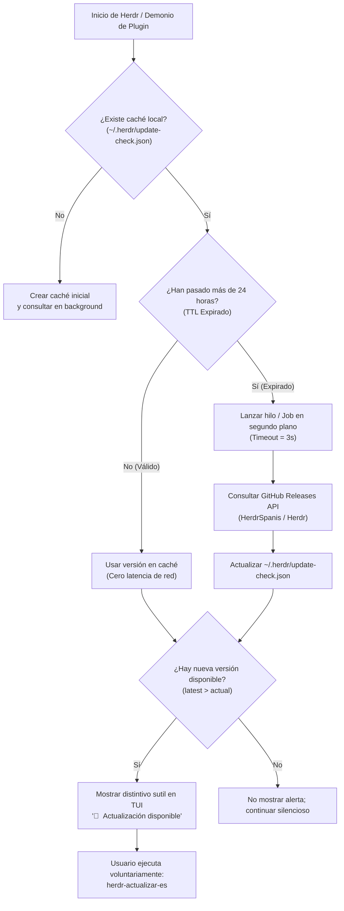

# ADR-002: Sistema Asíncrono No Intrusivo de Notificación de Actualizaciones con GitHub Releases y Caché TTL

## Contexto

El proyecto oficial de Herdr (`upstream`) evoluciona de forma ágil, lanzando nuevas versiones con mejoras de estabilidad, soporte para agentes adicionales y ajustes en su emulador de terminal Ghostty. A su vez, `HerdrEspañol` mantiene el compromiso de proporcionar traducciones sincronizadas y binarios optimizados para el ecosistema en español.

No obstante, la comprobación de actualizaciones en herramientas CLI y TUI presenta retos críticos de diseño de experiencia de usuario (UX) e infraestructura:
1. **Latencia de Arranque (Startup Penalty)**: Si la aplicación realiza peticiones HTTP/REST a la API de GitHub (`api.github.com`) de manera sincrónica en el hilo principal durante la inicialización, la TUI se congela entre 500 ms y 3000 ms antes de mostrar la primera pantalla.
2. **Entornos Offline y Aislamiento**: Desarrolladores que trabajan en aviones, trenes o redes corporativas restringidas sufrirían bloqueos por *timeouts* o excepciones molestas.
3. **Límite de Tasa de GitHub (Rate Limiting)**: La API pública no autenticada de GitHub impone un estricto límite de 60 peticiones por hora por dirección IP. Un usuario que abre múltiples ventanas o terminales saturaría la cuota de inmediato.
4. **Intrusividad Visual**: Las alertas modales emergentes (*popups* bloqueantes) interrumpen el flujo de programación de alta concentración.

---

## Decisión

Se adopta un **mecanismo de comprobación asíncrono y desacoplado, con persistencia en caché local y ventana TTL (Time-To-Live) de 24 horas**.



### 1. Esquema de Persistencia en Caché Local (`update-check.json`)

El estado de la verificación se almacena en el directorio del usuario `$HOME/.herdr/update-check.json` con la siguiente estructura:

```json
{
  "schema_version": 1,
  "last_check_timestamp": 1731024000,
  "last_check_iso": "2026-11-08T00:00:00Z",
  "current_installed_version": "0.9.5",
  "latest_remote_version": "0.9.6",
  "has_update": true,
  "release_url": "https://github.com/quijotevitruvio/HerdrSpanis/releases/tag/v0.9.6-espanol",
  "binary_download_url": "https://github.com/quijotevitruvio/HerdrSpanis/releases/download/v0.9.6-espanol/herdr-es.exe"
}
```

### 2. Política de Time-To-Live (TTL = 24 Horas)

- Si `(CurrentTimestamp - last_check_timestamp) < 86400`, la aplicación lee el archivo JSON en microsegundos y omite cualquier llamada de red.
- Si el TTL ha expirado, el proceso ejecuta una consulta desacoplada hacia el endpoint:
  ```http
  GET https://api.github.com/repos/quijotevitruvio/HerdrSpanis/releases/latest
  User-Agent: HerdrSpanis-UpdateChecker/0.2.1
  ```
- Si la máquina se encuentra sin conexión o la petición responde con `403 Rate Limit Exceeded`, el sistema falla silenciosamente, renueva el timestamp por 6 horas para evitar bucles de reintento agresivos, y permite al usuario seguir programando sin interrupciones.

### 3. Notificación No Intrusiva en la Barra Lateral (`sidebar.rs`)

En lugar de lanzar diálogos bloqueantes, el renderizador de la barra lateral (`sidebar.rs`) inspecciona la bandera `has_update`. Cuando es afirmativa, se añade en el pie del panel de espacios (`footer`):

```text
┌─ espacios ──────────────────┐
│ 󰝰 mi-backend               │
│ 󰉋 front-app                │
├─────────────────────────────┤
│ 󰚰 v0.9.6 disponible        │
│   'herdr-actualizar-es'     │
└─────────────────────────────┘
```

El glifo `󰚰 ` (`\u{F06B0}` en Nerd Fonts) en color ámbar suave (`ratatui::style::Color::Rgb(255, 193, 7)`) informa de la novedad sin secuestrar el cursor ni la entrada del teclado.

### 4. Automatización de Actualización Segura (`herdr-actualizar-es.ps1`)

El comando `herdr-actualizar-es` materializa la actualización:
1. Detecta la versión oficial más reciente instalada en `$HOME\.herdr\packages\standalone\releases`.
2. Preserva una copia de seguridad `herdr-original.exe` del binario upstream.
3. Descarga el binario traducido y optimizado desde GitHub Releases, o compila localmente mediante Zig 0.16.0 y Cargo si se especifica `-ForceRebuild`.
4. Copia las dependencias de bajo nivel (`conpty/`, avisos de terceros).
5. Actualiza atómicamente el enlace simbólico o junction `current` apuntando a la nueva carpeta `*-espanol`.

---

## Consecuencias

### Positivas
- **Arranque Inmediato (0 ms Penalty)**: Ninguna petición de red bloquea el ciclo de dibujado de `ratatui`.
- **Inmunidad al Rate Limit de GitHub**: El consumo máximo por usuario es de solo 1 petición cada 24 horas.
- **Tolerancia a Fallos Offline**: Si el usuario no tiene conexión a internet, Herdr inicia a velocidad completa sin arrojar advertencias ni errores en consola.
- **Actualización en un Solo Comando**: El desarrollador tiene control total de cuándo sincronizarse sin pérdidas de configuración.

### Consideraciones y Mitigaciones
- **Ventana de Propagación de 24 Horas**: Un usuario podría tardar hasta un día en ver el aviso de una nueva versión recién publicada.  
  *Mitigación*: Se puede forzar una comprobación manual inmediata ejecutando `herdr-actualizar-es -CheckOnly`.

> [!TIP]
> Puedes verificar el flujo de sincronización del código fuente en `[[GRAPHIFY-ARCHITECTURE]]` y los atajos de mantenimiento en `[[README]]`.
