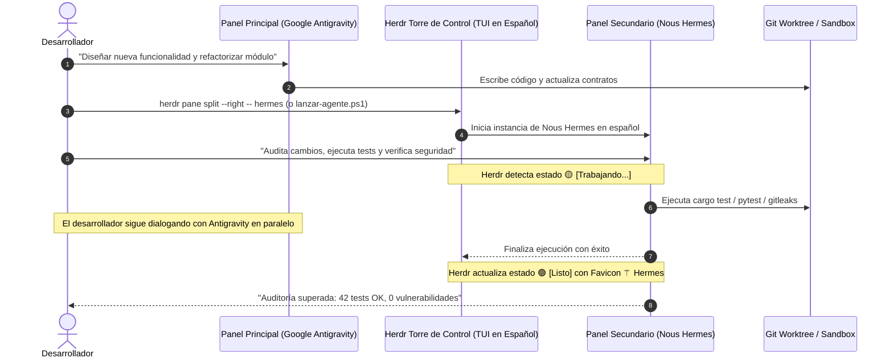

# ADR-003: Patrón de Escuadrón Multi-Agente con Nous Hermes en Herdr

## Contexto

El desarrollo de software moderno con Inteligencia Artificial ha evolucionado desde el uso de un único asistente interactivo hacia la **colaboración de múltiples agentes especializados en paralelo**. 

En flujos de trabajo convencionales:
- Los modelos orquestadores de alta capacidad de razonamiento (como **Google Antigravity** o **Claude 3.7 Sonnet**) suelen ser empleados para la redacción de especificaciones, decisiones de arquitectura y programación guiada.
- Sin embargo, someter al agente principal a tareas mecánicas intensivas —tales como correr suites completas de pruebas unitarias/E2E, compilar binarios pesados en Rust/Go, realizar auditorías de seguridad OWASP/Gitleaks o revisar estilos de código— consume excesivos tokens de ventana de contexto, incrementa los costos y genera tiempos de espera muertos donde el desarrollador no puede continuar interactuando.
- La ejecución en ventanas de terminal desordenadas ocasiona pérdida de visibilidad: no es evidente si una auditoría en segundo plano ya concluyó, falló o se quedó detenida esperando aprobación interactiva (`blocked`).

---

## Decisión

Se define formalmente el **Patrón de Escuadrón Multi-Agente Asíncrono (Agent Pod / Swarm Pattern)** en Herdr, empleando a **Nous Hermes (Hermes Agent / Nous Research)** como el agente de auditoría, pruebas continuas y tareas en segundo plano (*Background Worker & Reviewer*), mientras el desarrollador y el agente principal (**Google Antigravity** o **Claude Code**) trabajan en la estación principal.



### 1. Asignación de Roles en el Escuadrón Multi-Agente

| Rol | Agente | Favicon & Color | Responsabilidades Principales |
| :--- | :--- | :---: | :--- |
| **Arquitecto / Orquestador Primario** | **Google Antigravity** (`agy`) / **Claude Code** | `󰚩 ` Azul `#4285F4` / `󰭻 ` `#D97757` | Lógica de negocio, diseño de software, refactorizaciones complejas, interacción con el usuario. |
| **Auditor / Tester en Segundo Plano** | **Nous Hermes** (`hermes`) | `⚚ ` Carmesí `#FF6B6B` | Revisión estricta de código, validación de tipos, ejecución de suites de pruebas, escaneo de secretos y benchmarks. |
| **Torre de Control & Árbitro** | **Herdr (HerdrEspañol)** | `󰈸 ` / `󰚩 ` | Supervisión del ciclo de vida en tiempo real, conmutación de foco (`Ctrl+b`), partición de paneles y avisos de estado. |

### 2. Aislamiento de Entorno con Git Worktrees (`󰙅 `)

Para prevenir condiciones de carrera en el sistema de archivos (ej. Hermes ejecutando `cargo clean` o `cargo test` mientras Antigravity escribe en el mismo archivo fuente), se aprovecha el soporte nativo de Herdr para **Git Worktrees**:

- El espacio principal reside en la rama de desarrollo activa (icono de carpeta `󰝰 ` abierta).
- Para la auditoría de Hermes, se crea un worktree desacoplado con el atajo de menú contextual `Nuevo worktree` (renderizado con el glifo `󰙅 ` en `sidebar.rs`).
- Hermes opera en su propio directorio de trabajo de compilación sin bloquear las operaciones de Antigravity.

### 3. Supervisión Visual en Tiempo Real

Gracias a `[[ADR-001-localizacion-y-favicons-rust]]`, el desarrollador visualiza en la barra lateral el estado exacto de cada miembro del escuadrón:

```text
┌─ espacios ──────────────────┐┌─ 󰚩 Antigravity (Listo) ──────────────────────────┐
│ 󰝰 HerdrEspañol [main  ]    ││ $ agy "generar nueva arquitectura"             │
│   󰙅 worktree-auditoria-hermes││ > Analizando dependencias y contratos...        │
├─ agentes ───────────────────┤├─ ⚚ Hermes (Trabajando...) ───────────────────────┤
│ 󰚩 Antigravity  [Listo]      ││ $ cargo test --workspace                        │
│ ⚚ Hermes       [Trabajando] ││ > Running 42 tests across 8 suites...           │
│ 󰭻 Claude       [Listo]      ││                                                 │
└─────────────────────────────┘└─────────────────────────────────────────────────┘
```

Si Hermes encuentra un caso que requiere confirmación (por ejemplo, autorizar la sobrescritura de una prueba de integración), su estado cambia de inmediato a:
🔴 `⚚ Hermes [Esperando tu respuesta]`  
El desarrollador pulsa `Ctrl+b` + flechas de dirección para enfocarse en el panel de Hermes, aprobar la acción con `Enter`, y retornar a su conversación con Antigravity en menos de 2 segundos.

### 4. Automatización de Despliegue del Escuadrón (`lanzar-agente.ps1`)

Se integra el script `scripts/lanzar-agente.ps1` que configura el entorno en español y divide la ventana de forma ergonómica:

```powershell
# Lanzar Nous Hermes en panel vertical a la derecha
.\scripts\lanzar-agente.ps1 -Agente hermes -Direccion right

# O mediante comandos nativos de Herdr
herdr pane split --right -- hermes
```

---

## Consecuencias

### Positivas
- **Multiplicación de Productividad**: El desarrollador no experimenta bloqueos mientras se ejecutan pruebas lentas o análisis estáticos.
- **Eficiencia en Tokens y Contexto**: Antigravity mantiene su contexto limpio enfocado únicamente en la lógica del código, delegando el log masivo de tests y linters a Hermes.
- **Supervisión Centralizada**: Cero ventanas flotantes dispersas; toda la flota de agentes se inspecciona de un vistazo en la consola unificada de Herdr.

### Recomendaciones Operativas
> [!IMPORTANT]
> - Utilizar siempre `git worktree` cuando los agentes concurrentes compilen artefactos binarios o ejecuten herramientas que modifiquen el árbol de trabajo (`git checkout`, `build/`).
> - Mantener abiertas un máximo de 3 a 4 instancias concurrentes por workspace para evitar saturación de CPU/GPU en máquinas locales.

> [!TIP]
> Consulta el mapeo de llamadas y eventos en `[[GRAPHIFY-ARCHITECTURE]]` para examinar cómo se arbitran los estados de detección entre múltiples agentes activos.
