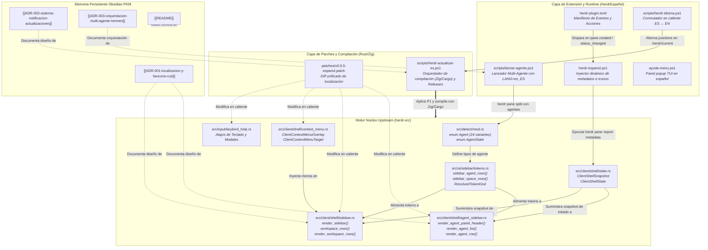

# Grafo de Conocimiento Arquitectónico (AST): Upstream Rust vs Artefactos HerdrEspañol

Este documento constituye el **mapa topológico y de dependencias AST (Abstract Syntax Tree)** que vincula los componentes del motor original en Rust (`herdr-src/`) con los artefactos de localización, parches, scripts de automatización y plugins de `HerdrEspañol`.

> [!NOTE]
> Siguiendo el flujo simbiótico de **Graphify + Obsidian**, este grafo preserva la memoria persistente de la arquitectura del proyecto, optimiza el consumo de tokens en prompts de agentes IA y permite auditar en segundos el impacto de cualquier cambio upstream.

---

## 1. Visualización del Grafo de Conocimiento AST



---

## 2. Matriz de Nodos AST y Trazabilidad

| Nodo Fuente Upstream | Entidad AST Principal | Archivo de HerdrEspañol Vinculado | ADR Vinculado | Responsabilidad Arquitectónica |
| :--- | :--- | :--- | :--- | :--- |
| `src/detect/mod.rs` | `enum Agent`, `Agent::ALL: [Self; 24]`, `enum AgentState` | `herdr-espanol.ps1`, `patches/v0.9.5-espanol.patch` | `[[ADR-001-localizacion-y-favicons-rust]]` | Define el catálogo completo de 24 agentes IA detectables y sus estados (`Idle`, `Working`, `Blocked`, `Unknown`). |
| `src/ui/sidebar/tokens.rs` | `sidebar_agent_rows()`, `sidebar_space_rows()`, `ResolvedTokenKind` | `patches/v0.9.5-espanol.patch` | `[[ADR-001-localizacion-y-favicons-rust]]` | Resuelve los tokens de visualización y asocia etiquetas a cada fila de agente o espacio. |
| `src/client/shell/agent_sidebar.rs` | `render_agent_panel_header()`, `render_agent_list()`, `render_agent_row()`, `sidebar_status_text()` | `patches/v0.9.5-espanol.patch`, `herdr-espanol.ps1` | `[[ADR-001-localizacion-y-favicons-rust]]` | Renderizado visual del panel lateral de agentes, cabeceras en español (`agentes`, `agrupados`, `prioridad`), favicons y colores RGB. |
| `src/client/shell/sidebar.rs` | `render_sidebar()`, `workspace_rows()`, `render_workspace_rows()` | `patches/v0.9.5-espanol.patch` | `[[ADR-001-localizacion-y-favicons-rust]]`, `[[ADR-002-sistema-notificacion-actualizaciones]]` | Renderizado del panel de espacios (`espacios`, `nuevo`, `menú`), iconos de carpetas (`󰝰 `, `󰉋 `), worktrees (`󰙅 `), ramas Git (` `) y footer de actualizaciones. |
| `src/client/shell/context_menu.rs` | `ClientContextMenuOverlay::items()`, `ClientContextMenuTarget` | `patches/v0.9.5-espanol.patch` | `[[ADR-001-localizacion-y-favicons-rust]]` | Opciones de menú contextual del botón derecho traducidas (`Renombrar`, `Cerrar`, `Nuevo worktree`, `Expandir`, `Contraer`). |
| `src/client/shell/state.rs` | `ClientShellSnapshot`, `ClientShellWorkspace`, `ClientShellAgent` | `herdr-espanol.ps1` | `[[ADR-003-orquestacion-multi-agente-hermes]]` | Estructuras de datos del estado de la terminal; recibe metadatos inyectados desde `herdr pane report-metadata`. |
| `src/input/keybind_help.rs` | `keybind_help_text()` | `patches/v0.9.5-espanol.patch`, `ayuda-menu.ps1` | `[[ADR-001-localizacion-y-favicons-rust]]` | Textos del diálogo modal de ayuda de atajos de teclado (`Ctrl+b`, particiones, navegación). |
| Build Toolchain (`Cargo.toml`) | `herdr binary target` | `scripts/herdr-actualizar-es.ps1` | `[[ADR-002-sistema-notificacion-actualizaciones]]` | Proceso de compilación con `zig.exe 0.16.0` y `cargo build --release --bin herdr`. |
| Plugin Runtime (`~/.herdr/plugins`) | `herdr-plugin.toml` | `herdr-plugin.toml`, `herdr-espanol.ps1` | `[[ADR-001-localizacion-y-favicons-rust]]`, `[[ADR-003-orquestacion-multi-agente-hermes]]` | Suscripción reactiva a eventos del shell de Herdr para inyección sin recompilación obligatoria. |

---

## 3. Protocolo de Extracción y Actualización Continua (Graphify)

Para mantener este grafo sincronizado automáticamente con los cambios en el código fuente de upstream o de los parches:

```bash
# 1. Extraer o actualizar el grafo AST completo hacia la bóveda Obsidian
graphify . --obsidian

# 2. Actualización incremental tras aplicar parches o modificar scripts
graphify . --update

# 3. Instalación del hook de Git para regeneración automática en cada commit
graphify hook install
```

> [!TIP]
> Al realizar code reviews o refactorizaciones con **Google Antigravity** o **Nous Hermes** (según `[[ADR-003-orquestacion-multi-agente-hermes]]`), este documento actúa como mapa mental de contexto ultraligero que evita releer miles de líneas de Rust innecesariamente.
